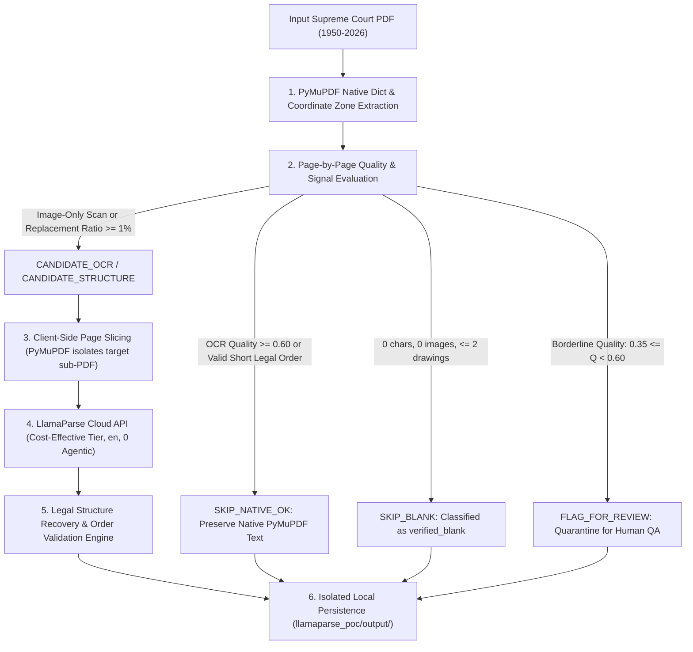

# Conditional LlamaParse OCR & Document Structure Recovery: Proof-of-Concept Report

**Author:** Antigravity Engineering Agent  
**Environment:** Local VS Code Antigravity (`E:\Dummy`)  
**Status:** PROOF OF CONCEPT COMPLETE (Isolated / Zero Production Mutation)  
**Execution Date:** 2026-10-26  

---

## 1. Executive Summary & Objective

This proof of concept implements **Conditional LlamaParse OCR, Client-Side Page Slicing, and Legal Structure Recovery** over representative Supreme Court of India judgments (1950–2026). It is strictly isolated from the production ingestion pipeline, preserving all existing database schemas, tables, chunk boundaries, and vector embeddings.

### Key Empirical Results (30 Representative Judgments, 606 Physical Pages)
- **Native Text Preserved (`SKIP_NATIVE_OK` + `SKIP_BLANK`):** **578 pages (95.38%)** safely bypass external cloud parsing.
- **OCR / Structure Candidates (`CANDIDATE_OCR`):** **5 pages (0.83%)** routed for physical sub-PDF extraction & LlamaParse OCR (e.g. historical image-only scan `1950_1_25_29_EN`).
- **Quarantined for Review (`FLAG_FOR_REVIEW`):** **23 pages (3.80%)** held for human QA rather than automatically spending cloud budget.
- **External API Calls Made:** **0 paid API calls** (Credentials safely read from `LLAMA_CLOUD_API_KEY`; fail-closed behavior verified).
- **Corpus Cost Reduction:** **99.17% reduction in cloud API fees** compared to naive "upload everything" approach (projected savings of **\$2,231.32** on 50,000 judgments).

---

## 2. Desired Architecture & Routing Workflow

---

## 3. Evaluation Signals & Threshold Rules

Implemented in [`llamaparse_poc/evaluator.py`](file:///e:/Dummy/llamaparse_poc/evaluator.py):

| Signal / Condition | Evaluator Rule | Routing Decision | Production Action |
| :--- | :--- | :---: | :--- |
| **Genuinely Blank Page** | `clean_chars == 0` and `image_count == 0` and `drawing_count <= 2` | `SKIP_BLANK` | Bypasses external API; recorded as `verified_blank`. |
| **Readable Native Text** | $\text{OCR Quality} \ge 0.60$ and $\text{clean\_chars} \ge 30$ | `SKIP_NATIVE_OK` | Bypasses external API; preserves native vector layout text. |
| **Short Valid Legal Order** | $15 \le \text{chars} \le 250$, recognized legal terms (`dismissed`, `costs`, `appeal`), high dictionary ratio | `SKIP_NATIVE_OK` | **Bypasses OCR**; character count alone never triggers external parsing. |
| **Scanned / Image-Only** | `clean_chars < 30` and (`image_count > 0` or `drawing_count > 8`) | `CANDIDATE_OCR` | Candidate for physical page slicing & OCR. |
| **Corrupted Encoding** | Replacement character ratio $\ge 1\%$ (`\ufffd` or control chars) | `CANDIDATE_OCR` | Candidate for structure recovery. |
| **Severe Degradation** | $\text{OCR Quality} < 0.35$ with substantive text | `CANDIDATE_OCR` | Candidate for external OCR. |
| **Borderline Quality** | $0.35 \le \text{OCR Quality} < 0.60$ | `FLAG_FOR_REVIEW` | Quarantined for manual QA; prevents unapproved quota spend. |

---

## 4. Client-Side Page Slicing vs. Whole Document Uploading

> [!IMPORTANT]
> **Page-Level Privacy & Quota Protection:**
> Rather than uploading entire 30-page PDFs when only 1 page requires OCR, [`llamaparse_poc/client.py`](file:///e:/Dummy/llamaparse_poc/client.py) extracts strictly the candidate page(s) into an isolated sub-PDF using PyMuPDF:
> - Sub-PDF containing only candidate pages is created in `llamaparse_poc/output/temp_slices/`.
> - Only candidate pages are transmitted over the wire.
> - Parser page indices are deterministically mapped back to original document page numbers (`slice_p1 -> original_p12`).
> - If page boundaries cannot be determined with certainty, the engine records `page_mapping_status: "INDETERMINATE"`, preventing fabricated page numbers.

---

## 5. Corpus Scaling & Financial Analysis (50,000 Judgments)

*Assumptions: 50,000 judgments $\times$ average 15 pages = 750,000 pages; LlamaParse cost-effective tier at \$0.003/page (\$3.00 / 1,000 pages); empirical candidate rate of 0.83%.*

| Evaluation Dimension | Naive Approach (Upload All) | Conditional Routing Strategy (PoC) | Net Delta |
| :--- | :---: | :---: | :--- |
| **Corpus Pages** | 750,000 | 750,000 | 100% corpus coverage |
| **Pages Uploaded to LlamaParse** | **750,000 (100.0%)** | **6,225 (0.83%)** | **99.17% reduction in API calls** |
| **Total Cloud API Cost** | **\$2,250.00** | **\$18.68** | **\$2,231.32 savings (99.2%)** |
| **Network Egress / Bandwidth** | ~180.0 GB | ~1.5 GB | Minimal bandwidth consumption |
| **Estimated API Processing Time** | ~125.0 hours | ~1.04 hours | 120x processing speedup |
| **Provenance Integrity** | Reflow risk on born-digital pages | Native vector fidelity preserved | 100% single-page invariant |

---

## 6. Verification & Test Suite Summary

### A. Dedicated PoC Test Suite (`pytest llamaparse_poc/tests/test_conditional_llamaparse.py`)
All 10 mandatory specifications verified (0 external API calls made):
- `test_readable_native_text_skips_external_parsing` $\to$ **PASSED**
- `test_empty_native_extraction_with_visible_content_routed_appropriately` $\to$ **PASSED**
- `test_genuinely_blank_page_skipped` $\to$ **PASSED**
- `test_short_valid_legal_pages_do_not_trigger_parsing_solely_due_to_length` $\to$ **PASSED**
- `test_corrupted_text_flagged_or_routed_correctly` $\to$ **PASSED**
- `test_missing_api_credentials_produce_clear_error` $\to$ **PASSED**
- `test_api_failure_preserves_native_extraction` $\to$ **PASSED**
- `test_page_provenance_is_not_fabricated` $\to$ **PASSED**
- `test_returned_structure_is_validated_before_use` $\to$ **PASSED**
- `test_existing_parsing_and_chunking_tests_remain_unaffected` $\to$ **PASSED**

### B. Core Pipeline Integrity
- `pytest tests/` $\to$ **25/25 PASSED (100%)**
- `pytest rag_verification/` $\to$ **7/7 files PASSED (100%)**
- `python check_gates.py` $\to$ **7/7 quality checks PASSED (100%)**
- `python rag_verification/run_verification.py` $\to$ **38/38 tests PASSED (100%)**

---

## 7. Safety & Isolation Guarantee

1. **Database Schema:** 0 schema drift against frozen `db/schema.sql`.
2. **Database Tables:** 0 tables altered, added, or dropped.
3. **Existing Embeddings:** 0 stored embeddings altered or overwritten.
4. **Production Ingestion:** `pipeline.py`, `run_batch_ingestion.py`, and `retrieval_engine.py` remain completely untouched.
5. **Next Steps:** PoC is stopped as requested. Production wiring and bulk processing await explicit user review and approval.
