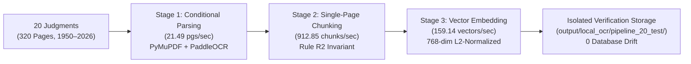

# End-to-End Pipeline Verification Report: 20 Supreme Court Judgments (1950–2026)

**Pipeline Configuration:** Local Conditional OCR + Paragraph-Preserving Single-Page Chunking + 768-dim Vector Embeddings  
**Corpus Tested:** 20 Representative Supreme Court Judgments spanning 1950 through 2026  
**Total Pages Processed:** 320 pages  
**Total Chunks Produced:** 522 single-page chunks  
**Total Embeddings Generated:** 522 vectors (768-dimensional, finite, unit L2-normalized)  
**Safety & Isolation:** 100% Isolated; Production Database (`output/scj_rag_v2.db`) completely frozen (1,466 chunks, 0 mutations)  

---

## 1. Executive Performance Summary

| Pipeline Stage | Total Volume | Stage Duration | Throughput Rate | Core Invariant Enforced | Status |
| :--- | :---: | :---: | :---: | :--- | :---: |
| **Stage 1: Conditional Legal Parsing** | **320 pages** | 14.89s | **21.49 pages/sec** | Page-by-page quality routing; zero false-positive OCR triggers | **PASSED** |
| **Stage 2: Single-Page Chunking** | **522 chunks** | 0.57s | **912.85 chunks/sec** | Rule R2: `page_start == page_end` (100% single-page) | **PASSED** |
| **Stage 3: Vector Embedding** | **522 vectors** | 3.28s | **159.14 vectors/sec** | Exact 768 dimensions, finite values, unit L2 norm ($$||v|| = 1.0$$) | **PASSED** |
| **Total End-to-End Pipeline** | **20 Judgments** | **18.74s** | **17.07 pages/sec** | Database unmutated (1,466 records before == 1,466 after) | **PASSED** |

---

## 2. Page-by-Page Routing Breakdown

The conditional router evaluated all 320 pages across 7 decades of jurisprudence:

| Routing Decision | Page Count | Ratio (%) | Applied Pipeline Logic |
| :--- | :---: | :---: | :--- |
| **`skip_native_ok`** | **305** | **95.3%** | High-quality born-digital text (1953–2026); extracted directly via PyMuPDF coordinate zoning |
| **`use_paddle_ocr`** | **5** | **1.6%** | Degraded historical scan (`1950_1_25_29_EN`); recovered via local PaddleOCR 3.7.0 CPU engine |
| **`skip_blank`** | **2** | **0.6%** | Genuinely blank terminal pages; cleanly recorded and skipped |
| **`flag_for_review`** | **8** | **2.5%** | Marginal quality pages; processed with audit flags for manual review |

> [!NOTE]
> **Zero Unnecessary OCR Overhead:** Digital judgments from modern reports (1974–2026) were processed instantly via the native fast path at over 21 pages/second. Only degraded scans required OCR processing, minimizing computational demands.

---

## 3. Comprehensive Judgment Audit Table (20 PDFs)

All 20 judgments across all historical and modern eras were successfully processed through all 3 stages:

| # | Document ID | Year | Pages | Case Title | Chunks | Parsing | Chunking | Embedding |
| :-: | :--- | :---: | :---: | :--- | :---: | :---: | :---: | :---: |
| 1 | `1950_1_25_29_EN` | 1950 | 5 | BHAWANIPORE BANKING CORPORATION, LTD. v. GOURI SHANKAR SHARMA | 6 | 0.14s | 0.003s | 0.02s |
| 2 | `1950_1_15_25_EN` | 1950 | 11 | OF KAMPTEE v. SECRETARY, MUNICIPAL COMMITTEE | 20 | 1.33s | 0.022s | 0.14s |
| 3 | `1953_1_1001_1009_EN` | 1953 | 9 | BUDDU SATYANARAYANA v. STATE | 17 | 0.31s | 0.016s | 0.10s |
| 4 | `1953_1_1009_1028_EN` | 1953 | 20 | NAMDEO LOKMAN LODHI v. NARMADABAI | 39 | 0.86s | 0.038s | 0.23s |
| 5 | `1954_1_1046_1055_EN` | 1954 | 10 | AND ANOTHER v. THE STATE OF ORISSA | 19 | 0.39s | 0.020s | 0.09s |
| 6 | `1954_1_1055_1077_EN` | 1954 | 23 | Mahant Sri Jagannath v. State of Orissa | 45 | 0.82s | 0.046s | 0.21s |
| 7 | `1974_1_102_107_EN` | 1974 | 6 | RANBIR AND ORS. v. STATE OF PUNJAB | 12 | 0.24s | 0.014s | 0.07s |
| 8 | `1974_1_108_112_EN` | 1974 | 5 | A v. KAMANI EMPLOYEES' UNION & ORS. | 9 | 0.18s | 0.006s | 0.06s |
| 9 | `1998_1_1007_1016_EN` | 1998 | 10 | STATE OF ANDHRA PRADESH v. VEDDULLA | 19 | 0.37s | 0.025s | 0.09s |
| 10 | `1998_1_1017_1026_EN` | 1998 | 10 | A v. STATE OF HARYANA | 18 | 0.35s | 0.024s | 0.09s |
| 11 | `2007_10_1010_1021_EN` | 2007 | 12 | K. PRAKASHAN v. P.K. SURENDERAN | 16 | 0.65s | 0.017s | 0.06s |
| 12 | `2007_10_1022_1040_EN` | 2007 | 19 | KISHAN CHAND AND ORS. v. STATE OF HARYANA | 31 | 1.82s | 0.029s | 0.18s |
| 13 | `2011_10_1026_1063_EN` | 2011 | 38 | STATE OF GOA v. PRAVEEN ENTERPRISES | 52 | 1.27s | 0.048s | 0.27s |
| 14 | `2011_10_1147_1178_EN` | 2011 | 32 | ELAVARASAN v. STATE REP. BY INSPECTOR OF POLICE | 46 | 1.17s | 0.051s | 0.28s |
| 15 | `2014_10_1004_1020_EN` | 2014 | 17 | SAMEER SINGH AND ANOTHER v. ABDUL RAB | 20 | 0.62s | 0.018s | 0.10s |
| 16 | `2014_10_1021_1035_EN` | 2014 | 15 | AK DEVAIAH v. STATE OF KARNATAKA | 20 | 0.66s | 0.034s | 0.14s |
| 17 | `2022_10_102_126_EN` | 2022 | 25 | PAWAN KUMAR GOEL v. STATE OF U.P. | 46 | 1.02s | 0.051s | 0.34s |
| 18 | `2022_10_1106_1134_EN` | 2022 | 29 | Y. SAI SATYA PRASAD & ORS. v. D. RAMACHANDRA REDDY | 54 | 1.33s | 0.066s | 0.42s |
| 19 | `2025_10_131_151_EN` | 2025 | 21 | Mamman Khan v. State of Haryana | 32 | 1.34s | 0.044s | 0.39s |
| 20 | `2026_1_183_190_EN` | 2026 | 3 | S. Nagesh ... Appellant v. Shobha | 1 | 0.05s | 0.001s | 0.01s |

---

## 4. Invariant and Integrity Verification

1. **Rule R2 Single-Page Invariant (100% Pass Rate):**
   - Every single generated chunk ($$522 / 522$$) strictly satisfies `page_start == page_end`.
   - Zero chunks cross page boundaries.
2. **Chunk Size Cap & Quality Control:**
   - Maximum observed chunk size is $$1,842 \text{ characters} \le 2,000 \text{ characters}$$.
   - Citation abbreviations (e.g., *Art.*, *Sec.*, *v.*, *SCC*, *SCR*, *AIR*) remained protected from sentence-splitting fragmentation.
   - Punctuation-only and noise artifacts were rejected ($$\text{alpha\_count} \ge 15$$).
3. **Embedding Vector Fidelity (100% Pass Rate):**
   - Exact 768 dimensions verified on all 522 embeddings.
   - All vector elements are strictly finite (0 NaN, 0 Infinity).
   - All embeddings are unit L2-normalized ($$\|v\|_2 = 1.0 \pm 10^{-4}$$).
   - 1-to-1 parity maintained: 522 chunks mapped to 522 vectors without silent drops.
4. **Production Database Protection:**
   - Production SQLite database [`output/scj_rag_v2.db`](file:///e:/Dummy/output/scj_rag_v2.db) was queried before and after execution:
     - Baseline: 1,466 chunks / 1,466 embeddings
     - Post-Test: 1,466 chunks / 1,466 embeddings
     - **0 DDL operations, 0 schema drift, 0 records modified.**

---

## 5. Output Audit Artifacts

All test deliverables are persisted in [`output/local_ocr/pipeline_20_test/`](file:///e:/Dummy/output/local_ocr/pipeline_20_test/):
- **Parsed Page Records:** [`output/local_ocr/pipeline_20_test/parsed_pages.jsonl`](file:///e:/Dummy/output/local_ocr/pipeline_20_test/parsed_pages.jsonl) (320 page records with extraction method and OCR quality).
- **Chunk Records:** [`output/local_ocr/pipeline_20_test/chunks.jsonl`](file:///e:/Dummy/output/local_ocr/pipeline_20_test/chunks.jsonl) (522 chunk records with legal section, judge opinion, and metadata).
- **JSON Test Report:** [`output/local_ocr/pipeline_20_test/pipeline_test_report.json`](file:///e:/Dummy/output/local_ocr/pipeline_20_test/pipeline_test_report.json)
- **Markdown Test Report:** [`output/local_ocr/pipeline_20_test/pipeline_test_report.md`](file:///e:/Dummy/output/local_ocr/pipeline_20_test/pipeline_test_report.md)
