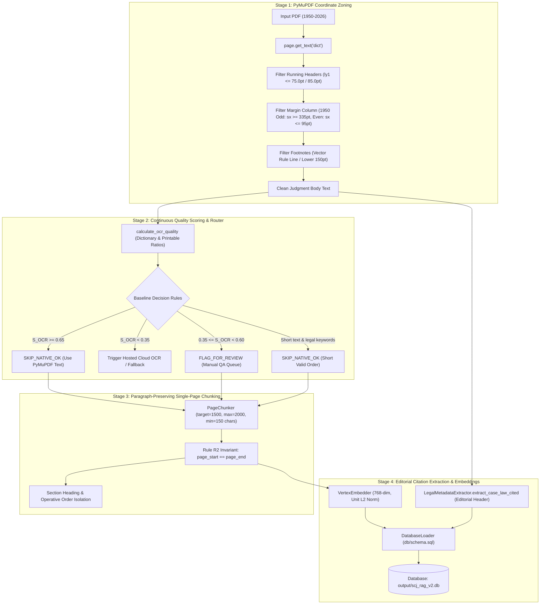

# Supreme Court Legal RAG — PCE v2 Engineering Approach (Baseline Pre-OCR / Prior to Changes)

**Document Version:** 2.0-Baseline (Pre-OCR)  
**Historical Context:** 25 Oct 2026 (2:30 PM) – 26 Oct 2026 (Pre-PaddleOCR)  
**Environment:** Hybrid Local PyMuPDF Vector Parsing + Cloud OCR Fallback Concept  
**Scope:** Architecture as originally designed prior to removing cloud dependencies, before implementing Local PaddleOCR, and before the citation extraction overhaul.  

---

## 1. Executive Summary & Design Scope

Following the debugging of PCE v1 from Oct 23 to Oct 25 (which suffered from recursive character splitting, severe multi-page chunk bleeding, and high LlamaParse cloud costs), the team discovered the fundamental **PCE v2 architecture** on **October 25, 2026 at 2:30 PM**.

The original PCE v2 baseline was designed with the following core principles:
1. **Coordinate Zone Extraction over Blind Text Dumps:** Replace naive PyMuPDF `get_text()` with physical bounding box inspection (`page.get_text("dict")`), separating running headers, page numbers, margin columns, footnotes, and judgment body paragraphs.
2. **Strict Single-Page Chunking (Rule R2):** Eradicate multi-page chunk bleeding by establishing the mathematical invariant:
   $$\forall c \in \text{Chunks},\quad c.\text{page\_start} == c.\text{page\_end}$$
3. **Continuous OCR Quality Scoring:** Evaluate extracted text quality using a continuous character-validity and legal dictionary hit formula ($S_{OCR} \in [0.0, 1.0]$).
4. **Relational Database Conformance:** Conform strictly to canonical `db/schema.sql` across 8 core relational tables in SQLite (WAL mode) and PostgreSQL.
5. **High-Fidelity Embeddings:** Produce 768-dimensional unit L2-norm vectors ($||\vec{v}||_2 = 1.0$) mapped 1:1 with stored chunks.

---

## 2. Pre-OCR Baseline Pipeline Architecture



---

## 3. Detailed Component Mechanics (Pre-OCR Baseline)

### 3.1 Stage 1: Physical Coordinate Zone Extraction (`parsing/zone_extractor.py`)
Rather than treating PDFs as unformatted plain strings, the baseline engine inspected the geometry of each text block:
- **Running Header Suppression:**
  - Historical SCR volumes: Lines with `ly1 <= 75.0` pt matching book title patterns (`SUPREME COURT REPORTS`, `S.C.R.`, case names).
  - Modern born-digital reports: Lines with `ly1 <= 85.0` pt containing appeal numbers or official headers.
- **Historical Margin Locator & Date Stripping:**
  - 1950–1975 reports featured margin locator letters (`A`, `B`, `C`, `D`, `E`, `F`, `G`, `H`) and margin years (`1950`, `1951`) printed in the margins.
  - On odd pages: Spans with $x_0 \ge 335.0$ pt were designated margin content and routed away from body text.
  - On even pages: Spans with $x_1 \le 95.0$ pt were designated margin content and routed away from body text.
- **Footnote Isolation:**
  - Detected horizontal vector rule lines at $y_0 \ge 0.65 \cdot h$ with width between 20 pt and 220 pt.
  - Text spans located below the rule line with font size $\le 8.5$ pt or starting with digit/bullet patterns (`(1)`, `(2)`, `*`) were isolated into `pz.footnotes`.

### 3.2 Stage 2: Continuous Quality Scoring (`calculate_ocr_quality`)
Quality was computed mathematically using legal lexicon density and printable ASCII ratios:
$$R_{dict} = \frac{\sum_{w \in \text{words}} \mathbb{I}(w \in \text{COMMON\_LEGAL\_WORDS})}{|\text{words}|}$$
$$R_{print} = \frac{\sum_{ch \in \text{text}} \mathbb{I}(ch.\text{isprintable}() \land \neg ch.\text{isspace}())}{|\text{text}|}$$
$$\text{Composite} = 0.75 \cdot R_{dict} + 0.25 \cdot R_{print}$$

- If `is_born_digital == True`:
  $$S_{OCR} = \min(1.0, \max(0.85, 0.85 + 0.15 \cdot R_{dict}))$$
- If `is_born_digital == False` (scanned/historical):
  $$S_{OCR} = \min(0.98, \max(0.10, \text{Composite} \cdot 1.1))$$

### 3.3 Stage 3: Baseline Routing Logic (`local_ocr/router.py`)
The router applied 8 rules to determine processing pathways:
1. `SKIP_BLANK`: Clean characters == 0, image count == 0, drawing count $\le 2$.
2. `USE_OCR`: Clean characters $< 30$ and visible images $> 0$.
3. `SKIP_NATIVE_OK`: Valid short legal order (e.g., "Appeal dismissed. No order as to costs.") having $< 200$ chars but containing valid legal keywords (`dismissed`, `costs`, `order`).
4. `USE_OCR`: Replacement characters $\ge 1\%$ (`\ufffd`).
5. `USE_OCR`: Severe degradation ($S_{OCR} < 0.35$).
6. `USE_PP_STRUCTURE`: Vector line drawing grids indicating tables.
7. `FLAG_FOR_REVIEW`: Borderline quality ($0.35 \le S_{OCR} < 0.60$) flagged for manual inspection.
8. `SKIP_NATIVE_OK`: Reliable native text ($S_{OCR} \ge 0.60$).

### 3.4 Stage 4: Single-Page Chunking (`chunking/page_chunker.py`)
- Guaranteed Rule R2 ($\text{page\_start} == \text{page\_end}$).
- Hard character ceilings: Target = 1,500 chars, Max = 2,000 chars, Min = 150 chars.
- Oversized paragraphs partitioned strictly along sentence boundaries (`. `, `! `, `? `).
- Heading classification: `FRONT_MATTER`, `STATEMENT_OF_FACTS`, `ISSUES`, `ARGUMENTS`, `REASONING`, `OPERATIVE_ORDER`.

### 3.5 Stage 5: Legacy Citation Extraction (`parsing/metadata_extractor.py`)
In the baseline design, citation extraction was strictly tied to editorial headings:
```python
clc_m = re.search(
    r"Case\s+Law\s+Cited\s*\n(.*?)(?=\n\s*(?:List\s+of\s+Acts|Appearances|Judgment)|$)", 
    text, re.IGNORECASE | re.DOTALL
)
```
If an explicit `"Case Law Cited"` heading was found (common in modern 2026 digital reports), citations were extracted line-by-line.

---

## 4. Bottlenecks & Gaps Identified in the Baseline Approach

During initial testing across the 75-judgment corpus, five significant architectural limitations emerged:

| Baseline Limitation | Root Cause in Baseline Design | Consequence in Initial Testing |
| :--- | :--- | :--- |
| **1. Citation Starvation (Only 1 DB row)** | Only looked for explicit `"Case Law Cited"` editorial heading; omitted in-text precedent patterns; dropped `pz.footnotes`. | 74 out of 75 judgments had 0 citations stored in `citations` table. |
| **2. Silent Fallback on Borderline Pages** | Rule 7 routed $0.35 \le S_{OCR} < 0.60$ to `FLAG_FOR_REVIEW`, but runner fell back to corrupted native PyMuPDF text. | Scanned 1953 judgments retained garbled operative orders and corrupted characters. |
| **3. Cloud Dependency Vulnerability** | Rule 2 & Rule 5 required hosted cloud OCR (LlamaParse) for degraded pages, incurring recurring cloud cost ($). | Inability to run 100% offline; required API keys and network access. |
| **4. False Historical Classification** | Checked `not ("2026" in document_id) and w < 500`. Modern A5 digital PDFs ($\text{year} \ge 1990$) were falsely marked as scanned paper. | Clean vector text was penalized by noisy OCR scoring algorithms. |
| **5. Stray Margin Header Leaks** | `purge_ocr_running_headers` only inspected the top 4 lines of a page. | Standalone margin years (`1953`) and collation numbers leaked into chunk content. |

---

## 5. Summary of Baseline State

The baseline PCE v2 design successfully established:
- **Rule R2 Single-Page Chunking** ($\text{page\_start} == \text{page\_end}$).
- **Continuous Quality Scoring** ($S_{OCR}$).
- **8-Table Relational Schema Conformance** against `db/schema.sql`.

However, resolving the cloud dependency, citation starvation, borderline quality fallback, and header leaks necessitated the **PCE v2 Production Overhaul (Local Conditional PaddleOCR + Footnote Citation Harvesting)**.

