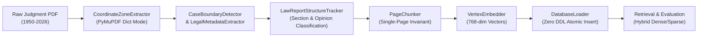
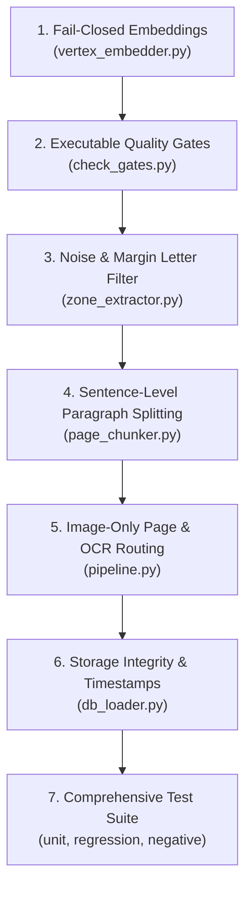

# Supreme Court Judgment RAG — Baseline Architecture & Defect Audit Report

**Date**: 26 October 2026  
**Workspace**: `E:\Dummy`  
**Git Branch**: `kedar/offline-process`  
**Auditor & Lead Architect**: Senior AI/ML & Legal NLP Engineering Team

---

## 1. Existing Architecture & Storage Contract

The Supreme Court of India Legal RAG System processes judgments spanning 1950 to 2026. The database storage contract is defined in `db/schema.sql` (PostgreSQL 16 with pgvector) and mirrored for local development in `output/scj_rag_v2.db` (SQLite). 

### Storage Invariants (Strictly Preserved - Zero DDL)
- **Tables (20)**: `embedding_models`, `judgments`, `source_files`, `ingestion_runs`, `extraction_runs`, `source_pages`, `chunks`, `chunk_embeddings`, `citations`, etc.
- **Single-Page Invariant (Rule R2)**: Every chunk must satisfy `page_start == page_end`.
- **Primary Keys**: UUIDv5 deterministically generated from document identifiers (`judgment_{doc_id}`, `sf_{doc_id}`, `chunk_{chunk_id}`).
- **Embedding Format**: 768-dimensional L2-normalized float arrays, stored inline in `chunks.embedding` (JSON/text in SQLite) and referenced in `chunk_embeddings`.

---

## 2. End-to-End Data Flow

1. **PDF Ingestion**: PyMuPDF (`fitz`) parses PDF span coordinates, bounding boxes, drawing rules, and text blocks.
2. **Zone Extraction**: Classifies headers, footers, body text, and margin notes.
3. **Structure & Metadata**: Extracts case title, year, bench, author judge, citations; tracks sections (`HEADNOTE`, `OPINION`, `ORDER`).
4. **Chunking**: Splits page text into paragraph chunks preserving section context.
5. **Embedding**: Prefixes canonical metadata and generates 768-dimensional dense vectors.
6. **Persistence**: Saves records across 9 relational tables inside atomic transactions.

---

## 3. Confirmed Defects & Root Cause Analysis

From the 9-page QA Audit Report and empirical codebase inspection:

| ID | Finding & Description | Severity | Root Cause | Responsible File |
|:---|:---|:---:|:---|:---|
| **C-01** | Pseudo-embedding fallback in production | **Critical** | `_init_vertex_client()` catches exception and silently falls back to `_generate_pseudo_vector()` (SHA-256 hash). | `embedding/vertex_embedder.py` (L58, L77, L84-93) |
| **C-02** | Hardcoded quality gates | **Critical** | `g7_passed = True` and `g9_passed = True` without executing retrieval or schema validation. | `check_gates.py` (L65–66) |
| **C-03** | Unverified SYNCED status | **Critical** | Hardcodes `'SYNCED'` on insertion without checking vector persistence; `last_synced_at` is null. | `storage/db_loader.py` (L365, L379) |
| **H-01** | Oversized chunks (> 2,000 chars) | **High** | Chunker accumulates paragraphs but never splits individual raw paragraphs exceeding `max_chunk_chars`. | `chunking/page_chunker.py` (L73–84) |
| **H-02** | 17,213 duplicate chunks of margin letters | **High** | Modern SCR margin locator letters `A, B, C, D, E, F, G` not stripped before paragraph grouping. | `parsing/zone_extractor.py` (L186–194) |
| **H-03** | Single-character & punctuation noise chunks | **High** | Punctuation on standalone lines emitted as chunks at section transitions because `alpha_count < 15` gate only applied to last chunk. | `chunking/page_chunker.py` (L84, L97) |
| **H-04** | 46 unhandled empty pages | **High** | Embedded image pages in digital PDFs produce empty text and are logged as `pymupdf_vector` with quality 0.99 instead of flagged image/OCR fallback. | `pipeline.py` (L107–129), `storage/db_loader.py` (L241) |
| **H-05** | Hardcoded OCR quality scores | **High** | `ocr_q = 0.99 if is_born_digital else 0.88` assigned statically without character or dictionary scoring. | `parsing/zone_extractor.py` (L196) |
| **H-06** | Silent vector truncation | **High** | `zip(chunks, vectors)` silently drops chunks if vector count doesn't match chunk count. | `embedding/vertex_embedder.py` (L113) |
| **H-10** | SQLite dialect vs PostgreSQL syntax | **High** | `storage/db_loader.py` uses raw SQL with dialect branching; requires strict parameter consistency. | `storage/db_loader.py` |
| **H-11** | Missing `content_sha256` in `source_files` | **High** | Column `content_sha256` omitted from SQL insert statements for `source_files`. | `storage/db_loader.py` (L128–167) |
| **H-13** | Null run lifecycle timestamps | **High** | `started_at`, `finished_at`, `heartbeat_at` omitted from `ingestion_runs` and `extraction_runs`. | `storage/db_loader.py` (L172–230) |

---

## 4. Existing Test Coverage & Baseline Measurements

- **Existing Tests**: `tests/test_pipeline.py` (6 unit tests covering margin isolation, boundary detection, metadata extraction, structure tracker, single-page chunking, and pipeline execution).
- **Current Test Status**: 6 passed in 2.16s when `output/scj_rag_v2.db` is present.
- **Database Baseline (Pre-Audit Snapshot)**:
  - Total Judgments: 6,088
  - Total Pages: 107,325
  - Total Chunks: 145,934
  - Chunks > 2,000 chars: 57,054 (39.1%)
  - Margin letter duplicates (`A\n\nB...`): 17,213
  - Empty pages: 46

---

## 5. Target Implementation & Verification Plan

1. **Embedding Hardening**: Fail closed in production (`allow_mock=False`). Strict shape/finite/dimension (768) assertions. Explicit `assert len(chunks) == len(vectors)`.
2. **Quality Gates**: Dynamic evaluation of Gate G7 (executable retrieval benchmark) and Gate G9 (schema validation against `db/schema.sql`).
3. **Extraction & Reflow**: Strip vertical margin locator letters `(?m)^\s*[A-H]\s*$`. Calculate dynamic dictionary word-validity OCR score.
4. **Chunking Bounds**: Sentence-level chunk splitting with legal citation protection for paragraphs > 2,000 chars. Noise filter (`alpha_count < 15`) at all block emissions.
5. **Image & Empty Page Handling**: Detect pages with images but no digital text, assign `image_only_pending_ocr` or run OCR fallback; detect `verified_blank`.
6. **Persistence Contract**: Record `content_sha256`, populate `started_at`/`finished_at`/`heartbeat_at`, verify vector persistence before recording `SYNCED` and set `last_synced_at`.
