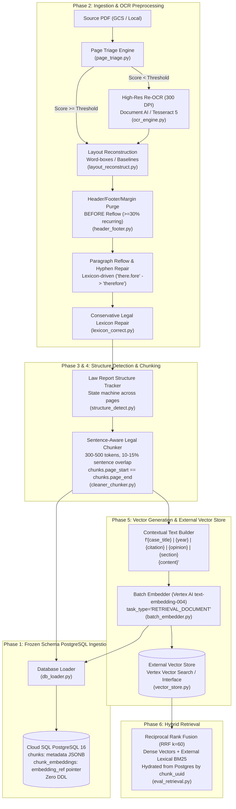

# Implementation Plan: Supreme Court Judgment RAG Ingestion Pipeline Overhaul

**Target System**: Indian Supreme Court Judgment Corpus (~43,000 PDFs, 1950–Present)  
**Corpus Characteristics**: Scanned 1950s SCR law reports (~400×616 pt) with poor embedded OCR text layers, progressing to modern born-digital judgments.  
**Schema Status**: **FROZEN Cloud SQL PostgreSQL 16 schema** (`legal_rag_cloudsql_postgresql_schema.sql` / `db/schema.sql`).  

---

## 1. Executive Summary & Hard Invariants

This plan establishes a phased, test-driven engineering roadmap to completely resolve verified OCR noise, inline header leakage, opinion boundary misattributions, mid-sentence chunking cuts, and mock vector leakage across the ingestion pipeline.

### Hard Rules Compliance Matrix

| Rule | Requirement | Architectural Enforcement |
| :--- | :--- | :--- |
| **R1** | **FROZEN DB Schema** | Zero DDL executed. Zero column additions to tables (`chunks.embedding`, `chunks.chunk_id`, and `chunk_embeddings.embedding` do not exist in the frozen schema). All rich metadata (chunk_id, judge_opinion, ocr_quality, chunking_version, case_title, bench) is strictly persisted in `chunks.metadata` JSONB. Vectors reside in an external vector store and are referenced via `chunk_embeddings.embedding_ref`. Schema proposals go to `docs/SCHEMA_CHANGE_PROPOSALS.md` only. |
| **R2** | **Page Boundary Invariant** | Chunks never cross physical pages: `chunks.page_start == chunks.page_end`. Cross-page paragraph continuity is tracked explicitly via metadata flags (`continues_from_prev_page`, `ends_mid_sentence`). |
| **R3** | **Zero Mock Vector Leakage** | Hard-fail in production when `ALLOW_MOCK_EMBEDDINGS=false` if Vertex AI is unavailable. Mock runs write strictly to local mock directories (`mock_embeddings/`) and never touch PostgreSQL, GCS deliverables, or production vector stores. |
| **R4** | **Credential Security** | No credentials in code. Centralized Secret Manager / environment pattern in `config.py`. |
| **R5** | **Completeness Gate** | Complete page accounting: $\text{pages\_in} == \text{pages\_extracted} + \text{pages\_quarantined}$. Zero silent page dropping. |

---

## 2. End-to-End System Architecture (Frozen Schema Compliant)

---

## 3. Phase-by-Phase Implementation Roadmap

### Phase 0: Baseline & Audit Harness
* **Objective**: Measure and save baseline metrics across the 4 landmark sample PDFs and current chunk JSONs before applying code changes.
* **Module to Build**: `audit_quality.py`
  - Per-document and aggregate reporting:
    - Total chunk count, character/token distribution (min, median, max, std).
    - Percentage of chunks exceeding 2,000 characters.
    - Percentage of chunks ending mid-sentence or starting lowercase.
    - Exact header-leak count (fuzzy matching `"SUPREME COURT REPORTS"`, `"[1950]"`, running case titles, bare page numbers).
    - Junk-token ratio, dictionary hit rate, short-line ratio ($<3$ words), hyphenation break count.
    - Section heading null rate and validity (identifying fragments like `"Section 3"`, `"Part forms"`).
    - Judicial opinion label consistency.
    - Embedding sanity statistics: vector dimensionality, L2-norm, pairwise cosine similarity distribution, and mock vector detection flag (mean cosine within $\pm 0.05$).
* **Output Deliverable**: `reports/baseline.md` (baseline metrics locked for before/after comparison).

---

### Phase 1: Database Alignment (Frozen Schema Enforcement)
* **Objective**: Bring `db_loader.py`, `models.py`, `batch_embedder.py`, `pipeline.py`, and `gcp_production_pipeline.py` into 100% byte-for-byte compliance with `legal_rag_cloudsql_postgresql_schema.sql` (`db/schema.sql`).
* **Key Tasks**:
  1. **Schema Integrity**:
     - Remove all non-schema column references: `chunks.embedding`, `chunks.chunk_id`, `chunk_embeddings.embedding`, and SQLite-only DDL.
     - Ensure `db_loader.py` never issues `CREATE TABLE`, `ALTER TABLE`, or index commands.
  2. **Field Mapping strictly to Frozen Tables**:
     - `judgments`: `judgment_uuid` (deterministic `uuid5`), `judgment_id`, `court`, `case_number`, `judgment_date`, `citation_text` (`"[1950] S.C.R. 88"`), `reporter_citations`, `is_primary`. Note: No title/parties column exists in `judgments`; keep `case_title`, parties, bench, counsel in `chunks.metadata` JSONB and GCS manifests.
     - `citations`: Extracted citations (`citation_text`, `citation_type`, `normalized_citation`, `source_locator=page`).
     - `source_files`: `source_file_uuid`, `judgment_uuid`, `version_number`, `is_current`, `original_filename`, `storage_path`, `page_count`, `content_sha256`, `file_size_bytes`, `ingestion_status`, `pipeline_version`.
     - `source_pages`: `source_page_uuid`, `source_file_uuid`, `page_number`, `extraction_method`, `content` (clean page text), `quality_score` (`ocr_quality` $0.0-1.0$). Raw OCR text and logs go to GCS.
     - `chunks`: `chunk_uuid`, `judgment_uuid`, `source_file_uuid`, `extraction_run_uuid`, `last_seen_ingestion_run_uuid`, `chunk_index` (global 0-based index per source file), `page_start`, `page_end` (`page_start == page_end`), `content`, `section`, `content_sha256`, `is_active`.
     - `chunks.metadata` (JSONB object): Holds `"chunk_id"` (`"<doc>_p<page>_c<n>"`), `"judge_opinion"`, `"case_title"`, `"parties"`, `"bench"`, `"year"`, `"scr_citation"`, `"printed_page_number"`, `"ocr_quality"`, `"chunking_version"`, `"cleaning_version"`, `"continues_from_prev_page"`, `"ends_mid_sentence"`, `"raw_char_count"`, `"clean_char_count"`, `"header_stripped"`, `"corrections_count"`, `"embedding_text_version"`.
     - `chunk_embeddings`: `chunk_embedding_uuid`, `chunk_uuid`, `embedding_model_uuid`, `provider='vertex_ai'`, `vector_store='vertex_ai_vector_search'`, `corpus_resource_name`, `external_chunk_resource_name` (`chunk_uuid`), `embedding_ref` (`"<store>:<index>:<datapoint_id>:<version>"`), `sync_status='SYNCED'`, `last_synced_at`, `last_error`.
  3. **Re-processing Without Schema Modifications**:
     - New ingestion runs create a new `source_files` row with incremented `version_number`.
     - In a single transaction: `UPDATE source_files SET is_current = FALSE WHERE judgment_uuid = :juuid AND is_current = TRUE;` then insert new row with `is_current = TRUE`.
     - Set older version chunks to `is_active = FALSE`.
  4. **Schema Drift Test**:
     - Automated test: Run pipeline against PostgreSQL 16 schema, execute `pg_dump --schema-only` before and after. Output must be byte-identical. Assert zero DDL statements executed.

---

### Phase 2: Parsing & OCR Cleaning
* **Objective**: Eliminate junk tokens, inline running headers, broken hyphenation, and OCR skew across 1950s SCR law reports.
* **Order of Operations (Mandatory)**:
  $$\text{Triage} \longrightarrow \text{Re-OCR (if needed)} \longrightarrow \text{Layout Reconstruction} \longrightarrow \text{Header/Footer Purge} \longrightarrow \text{Reflow} \longrightarrow \text{Hyphen Repair} \longrightarrow \text{Lexicon Correction}$$
* **Modules to Build / Upgrade**:
  1. `page_triage.py`:
     - Computes per-page readability metrics: junk-token ratio, legal dictionary hit rate, average word length, short-line ratio, symbol density.
     - Outputs `ocr_quality` ($0.0 - 1.0$). Pages below triage threshold trigger high-resolution re-OCR.
  2. `ocr_engine.py`:
     - 300 DPI grayscale rasterization, OpenCV deskewing, Otsu adaptive binarization, shadow/border removal.
     - Document AI / Cloud Vision integration if credentials exist, falling back to Tesseract 5 (`--oem 1`, `psm 3` & `psm 4`, custom legal/judge user-words dictionary).
     - Keeps both embedded and OCR versions; selects the highest quality score; records route in metadata.
  3. `layout_reconstruct.py`:
     - Reconstructs text from bounding boxes; detects two-column legal layouts via x-histogram gap analysis; establishes reading order and paragraph boundaries from indentation and line height.
  4. `header_footer.py`:
     - **Execution BEFORE reflow**: Analyzes recurring lines across $\ge 30\%$ of pages at matching y-coordinates (token-set similarity $\ge 0.8$): `"SUPREME COURT REPORTS"`, case title headers, `"[1950]"`, page numbers, sheet signatures (`12-A`).
     - Extracts printed page number into metadata; strips headers from body text.
     - Secondary pass: Purges any residual inline occurrences of learned header strings.
  5. `lexicon_correct.py`:
     - Reflows hard-wrapped lines into continuous paragraphs.
     - Reassembles line-wrapped and page-wrapped hyphens (`there.\nfore` $\rightarrow$ `therefore`) verified against the legal lexicon.
     - Normalizes Unicode NFC, quotes, dashes, soft hyphens. Contextual numeral repair (`Art. 19 (l)(d)` $\rightarrow$ `Art. 19(1)(d)`, `19~0` $\rightarrow$ `1950`).
     - Conservative frequency-lexicon correction: Only corrects tokens within edit distance $\le 2$ against high-confidence legal terms and judge names. Logs every correction (page, before, after, rule, confidence).

---

### Phase 3: Structure Detection (Judicial Opinions & Sections)
* **Objective**: Guarantee $\ge 95\%$ section heading accuracy, eliminate false "ORDER" defaults, and isolate per-judge opinions.
* **Module to Build**: `structure_detect.py`
  - **Opinion Start Validation**: Detects opinion starts only at line/paragraph starts using validated patterns:
    `r"^(Per\s+)?[A-Z][A-Za-z.\s']{2,40}\s+(C\.\s?J\.|J\.|JJ\.)\s*[-—.:]"`
    Tolerant of OCR spacing (`"M UKHER JEA J ."`), verified against document coram and global judge lexicon.
    Rejects judge mentions inside sentence bodies and headnote bench summary lines.
  - **Document-Level State Machine**:
    $$\text{HEADNOTE / CATCHWORDS} \longrightarrow \text{COUNSEL / ARGUMENTS} \longrightarrow \text{OPINION - <JUDGE>} \longrightarrow \text{ORDER (operative only)}$$
    Active judge opinion persists across physical pages until the next judge's opinion or order begins.
  - **Mid-Page Opinion Splitting**: If a judge's opinion starts mid-page, splits that page's paragraphs so no chunk contains multiple opinions.
  - **Metadata Rollup**: Extracts case title, parties, year, SCR citation, bench, and decision date from pages 1–3 and filename patterns.

---

### Phase 4: Sentence-Aware Chunking
* **Objective**: Enforce 300–500 token target, zero mid-sentence cuts, and strict page boundary preservation.
* **Module to Upgrade**: `cleaner_chunker.py`
  - **Packing**: Paragraph- then sentence-aware packing into 300–500 tokens (hard cap 700 tokens). Merges $<50$ token fragments within the same page and section.
  - **Sentence Boundary Protection**: Protects legal abbreviations (`C.J.`, `JJ.`, `Art.`, `Sec.`, `v.`, `S.C.R.`, `A.I.R.`, `No.`) to eliminate mid-sentence breaks ($<2\%$ target).
  - **Sentence-Aligned Overlap**: 10–15% overlap formed strictly of whole trailing sentences from the preceding chunk on the same page/section.
  - **Page Boundary Invariant**: `chunks.page_start == chunks.page_end`. Chunks never merge across page boundaries.
  - **Continuity Metadata**: When a paragraph continues from the previous page, sets `continues_from_prev_page = true` and `ends_mid_sentence = true`.

---

### Phase 5: Embeddings & External Vector Store
* **Objective**: Generate 768-dim production Vertex AI embeddings, enforce mock vector isolation, and link to an external vector store.
* **Modules to Build / Upgrade**: `batch_embedder.py`, `vector_store.py`
  1. **External Vector Store Interface**:
     - `VectorStoreInterface`: Concrete implementations for `VertexVectorSearchStore` (asia-south1) and a local mock interface.
     - Datapoint ID = `chunk_uuid`. Metadata restrictions: `judgment_id`, `year`, `judge_opinion`, `section`, `is_active`, `chunking_version`, `embedding_text_version`.
  2. **Contextual Embedding Text**:
     $$\text{Embedding Text} = \text{case\_title} \parallel \text{year} \parallel \text{scr\_citation} \parallel \text{judge\_opinion} \parallel \text{section}\n\text{clean\_content}$$
     Chunk `content` remains clean and unmodified for user presentation.
  3. **Vertex AI Task Types**:
     - Document chunks: `TextEmbeddingInput(task_type="RETRIEVAL_DOCUMENT", title=case_title)`.
     - Queries: `task_type="RETRIEVAL_QUERY"` without prefix.
     - `output_dimensionality = 768`, L2-normalized ($\|v\|_2 = 1.0$), asserting finite values.
  4. **Production Mock Vector Isolation**:
     - Startup self-test: Embeds 3 probe sentences; aborts if similar legal texts do not separate from unrelated texts or if distribution matches Gaussian noise.
     - If `ALLOW_MOCK_EMBEDDINGS=false`, hard-fails immediately if Vertex AI is uninitialized. Mock vectors write strictly to `mock_embeddings/` and are never written to PostgreSQL `chunk_embeddings`, GCS deliverables, or production vector stores.
  5. **PostgreSQL Ledger Synchronization**:
     - `chunk_embeddings`: Records `chunk_uuid`, `embedding_model_uuid`, `provider='vertex_ai'`, `vector_store='vertex_ai_vector_search'`, `external_chunk_resource_name=chunk_uuid`, `embedding_ref="<store>:<index>:<chunk_uuid>:<version>"`, `sync_status='SYNCED'`.
     - Batched `executemany` (200/batch). Idempotency skips re-embedding if `SYNCED` unless `--force` is passed.

---

### Phase 6: Hybrid Retrieval Layer
* **Objective**: High-precision hybrid search without touching PostgreSQL schema or vector extensions.
* **Implementation in `eval_retrieval.py` / Application Layer**:
  - **Dense Retrieval**: Top-50 candidates from Vertex Vector Search via cosine similarity.
  - **Lexical Retrieval**: Top-50 candidates from an external lexical BM25 index with trigram/fuzzy matching on legal citations and noisy OCR party/judge names.
  - **Fusion**: Reciprocal Rank Fusion ($k=60$):
    $$\text{RRF\_Score}(d) = \frac{1}{60 + \text{rank}_{\text{dense}}(d)} + \frac{1}{60 + \text{rank}_{\text{lexical}}(d)}$$
  - **Reranker Hook**: Optional cross-encoder / Vertex Ranking API over top 30 candidates.
  - **Database Hydration**: Hydrates top 5–8 chunks from Cloud SQL PostgreSQL by primary key `chunk_uuid` joining `chunks` $\rightarrow$ `judgments` $\rightarrow$ `source_files`.

---

### Phase 7: Scale, Reliability & Labeled Evaluation
* **Objective**: Ground-truth benchmarking and resilient large-scale checkpointing.
* **Key Tasks**:
  - **Checkpoint & Resume**: Tracks document progress in `ingestion_runs` and `extraction_runs` (`idempotency_key = sha256(source_sha + pipeline_version + stage)`). Stale heartbeats enable seamless resume.
  - **Quarantine System**: Failed/unreadable pages set `source_files.ingestion_status = 'QUARANTINED'` with reason codes and manifest export.
  - **Labeled Ground-Truth Set**: ~60 pages across eras (including the 4 landmark samples and `INSC_2023_CA_1042`). Computes Character Error Rate (CER) and Word Error Rate (WER) across each cleaning stage.
  - **Gold Retrieval Set**: $\ge 150$ (query, expected chunk) pairs covering party names, judge holdings, statute/article questions, and noisy OCR terms. Evaluates Recall@5, Recall@10, and MRR.

---

### Phase 8: Pilot on 300+ Documents & Acceptance Gates
* **Objective**: Execute end-to-end pilot on $\ge 300$ stratified Supreme Court judgments with real Vertex embeddings, generating `reports/pilot_report.md` and verifying Acceptance Gates G1 through G11.
* **Stratification**:
  - ~40% 1950–1959 scanned SCR law reports.
  - ~30% 1960–1999 printed volumes.
  - ~20% 2000–2019 early digital reports.
  - ~10% 2020+ modern born-digital judgments.
  - Includes short single-page orders up to 250+ page constitutional bench rulings.

---

## 4. Acceptance Gates (G1 to G11)

| Gate | Acceptance Criteria | Target Metric |
| :--- | :--- | :--- |
| **G1** | Real Vertex Embeddings | 100% `provider='vertex_ai'`; 768-dim; $\|v\|_2 = 1.0 \pm 10^{-5}$; mean pairwise cosine $> 0.25$; 0 mock vectors in prod. |
| **G2** | Header / Footer Leakage | **0 chunks** contain running headers (`SUPREME COURT REPORTS`), printed page numbers, or margin year marks. |
| **G3** | Opinion & Section Accuracy | $\ge 95\%$ correct on hand-verified multi-judge chunks; 0 chunks contain multiple opinions; section non-null $\ge 95\%$; 0 fragment headings. |
| **G4** | Chunk Boundaries | Mid-sentence ends $\le 3\%$; lowercase starts $\le 3\%$; 0 chunks cross page boundary; token median 300–500 (95% within 150–700); $<50$ token chunks $<1\%$. |
| **G5** | OCR Quality Improvement | Junk-token ratio down $\ge 60\%$ vs baseline on 1950s scans; dictionary hit rate $\ge 0.92$; hyphen-split repair $\ge 98\%$. |
| **G6** | Completeness | $\text{pages\_in} == \text{pages\_extracted} + \text{pages\_quarantined}$ for 100% of documents. Quarantine rate $<3\%$. |
| **G7** | Retrieval Superiority | Hybrid RRF beats dense-only and legacy on Recall@5, Recall@10, MRR in all era slices. Name/judge queries Recall@10 $\ge 0.85$. |
| **G8** | Reliability & Idempotency | Re-run makes 0 vector-store/OCR calls and 0 database row changes. Kill-and-resume yields 0 duplicates. |
| **G9** | Schema Frozen | Drift test passes (`pg_dump --schema-only` byte-identical). Zero DDL executed. |
| **G10** | Referential Integrity | Valid foreign keys; `page_start == page_end`; contiguous `chunk_index` (0..n-1); valid `content_sha256`; metadata is valid JSONB object. |
| **G11** | Vector Store Consistency | Active chunks $==$ SYNCED `chunk_embeddings` $==$ vector store datapoints. 0 mock rows in prod tables. |

---

## 5. File Inventory & Actions

| File Path | Action | Role & Purpose |
| :--- | :--- | :--- |
| `audit_quality.py` | **Create** | Quality audit harness measuring tokens, headers, OCR metrics, opinion accuracy, and mock embeddings. |
| `page_triage.py` | **Create** | Per-page triage computing `ocr_quality` to dynamically route pages to high-res re-OCR. |
| `ocr_engine.py` | **Create** | 300 DPI preprocessing, deskewing, Document AI / Tesseract 5 dual-version OCR. |
| `layout_reconstruct.py` | **Create** | Bounding box clustering, column detection, reading order, and paragraph boundary detection. |
| `header_footer.py` | **Create** | Recurring header/footer coordinate and regex purge across pages prior to reflow. |
| `lexicon_correct.py` | **Create** | Hyphen repair across lines/pages and conservative legal/judge lexicon typographical corrections. |
| `structure_detect.py` | **Create** | Opinion start validation, whole-document state machine, mid-page splitting, metadata rollup. |
| `vector_store.py` | **Create** | External vector store interface with Vertex Vector Search adapter and local mock isolation. |
| `db_loader.py` | **Modify** | Rewrite to strictly match frozen schema (`db/schema.sql`); remove non-schema columns; map metadata to JSONB. |
| `models.py` | **Modify** | Align Pydantic models with frozen schema and rich `chunks.metadata` contract. |
| `batch_embedder.py` | **Modify** | Contextual embedding text, task types, tenacity retry, token batching, production mock isolation. |
| `cleaner_chunker.py` | **Modify** | Sentence-aware packing (300-500 tokens), whole-sentence overlap, strict page boundary invariants. |
| `extractor.py` | **Modify** | Pre-flight validation, coordinate bounding-box extraction, integration with `page_triage`. |
| `eval_retrieval.py` | **Modify** | External BM25 + Vector Search RRF fusion ($k=60$), comparative reporting. |
| `docs/SCHEMA_CHANGE_PROPOSALS.md` | **Create** | Architectural documentation of optional future schema improvements (proposals only; not applied). |
| `reports/baseline.md` | **Create** | Locked baseline audit metrics across the 4 landmark sample PDFs. |
| `reports/pilot_report.md` | **Create** | Full pilot benchmark results on 300+ documents with G1–G11 gate verification. |

---

## 6. Execution Order & Phase Protocol

1. **Phase 0**: Implement `audit_quality.py`, measure the 4 samples, write `reports/baseline.md`.
2. **Phase 1**: Align database loading and models strictly to frozen `db/schema.sql`, verify schema drift test.
3. **Phase 2**: Implement triage, re-OCR, layout reconstruction, header purge, and lexicon correction.
4. **Phase 3**: Implement structure detection, judge opinion tracking, and document metadata extraction.
5. **Phase 4**: Upgrade sentence-aware chunking with whole-sentence overlap and page boundaries.
6. **Phase 5**: Implement external vector store interface, contextual embeddings, and tenacity retries.
7. **Phase 6**: Wire hybrid retrieval with RRF ($k=60$) and Postgres hydration.
8. **Phase 7**: Assemble labeled evaluation dataset (~60 pages) and gold query set ($\ge 150$ queries).
9. **Phase 8**: Run 300+ document pilot, verify G1–G11 gates, and produce `reports/pilot_report.md`.

*After each phase*: Execute targeted unit/integration tests and run `audit_quality.py` to publish measured before/after verification numbers before proceeding.
